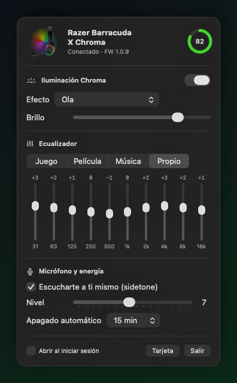
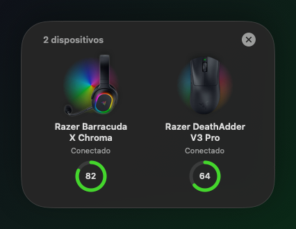
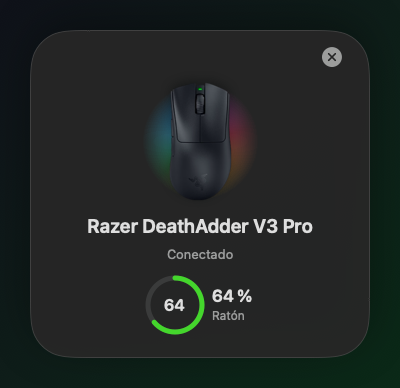

<div align="center">

# Synapseless

**Control nativo de macOS para el Razer Barracuda X Chroma, y soporte experimental para 159 ratones, teclados y laptops Razer.**
Funciona en Macs con Intel y con Apple silicon, sin Razer Synapse.

&nbsp;&nbsp;

</div>

---

## Por qué

Razer Synapse para Mac solo se instala en Macs con chip M, y aun ahí no reconoce el Barracuda X Chroma. Synapseless habla directamente con el receptor USB-C del audífono mediante el mismo protocolo HID que usa Synapse en Windows. Es una app de barra de menús, sin drivers ni extensiones de sistema.

## Funciones

| | |
|---|---|
| **Tarjeta de conexión** | Al prender los audífonos sube una tarjeta estilo AirPods desde abajo de la pantalla, con la render de tu edición, un halo Chroma y el anillo de batería. |
| **Animación de apagado** | Al apagarlos, o al desconectar el receptor, la tarjeta muestra las luces apagándose y «Desconectado». |
| **Tarjeta combinada** | Si se conecta otro dispositivo mientras la tarjeta está visible, se une a ella en columnas lado a lado, cada una con su propia animación. |
| **Iluminación Chroma** | Estático, Respiración (1 o 2 colores, o aleatoria), Espectro, Ola y Reactivo al audio, con brillo de 0 a 255. Los efectos corren en el firmware y se quedan guardados aunque cierres la app. |
| **Ecualizador** | Presets Juego, Película y Música, más uno propio de 10 bandas (31 Hz – 16 kHz, ±12 dB) guardado en el audífono. |
| **Micrófono** | Sidetone (escucharte a ti mismo) con nivel de 0 a 15. |
| **Energía** | Apagado automático (5–60 min o nunca), batería y estado de carga. |
| **Sincronización** | Si cambias el EQ o las luces con los botones del audífono, el menú se actualiza solo. |
| **Ediciones** | Detecta la edición (Negro, Blanco, Verde translúcido, Negro translúcido, Transparente) y muestra su render. |
| **Otros modelos** 🧪 | 159 ratones, teclados, laptops Blade y accesorios con efectos Chroma, brillo, DPI, polling y batería. Experimentales: [ver lista](DEVICES.md). |

<div align="center">
&nbsp;&nbsp;
</div>

## Otros modelos (experimental)



Al conectar cualquiera de los [159 modelos del catálogo](DEVICES.md), aparece su tarjeta con la render del producto (o un ícono, en teclados y laptops) y una pestaña propia en el menú:

- **Iluminación:** Estático, Respiración, Respiración aleatoria, Espectro, Ola, Apagado y brillo.
- **Ratones:** DPI dentro del rango del sensor y polling de 125, 500 o 1000 Hz (excepto en los HyperPolling).
- **Inalámbricos:** batería y estado de carga.

> [!WARNING]
> **Nada de esto se ha probado en hardware real.** El catálogo y los comandos salen del código de Synapse 4 y de la documentación de openrazer. Al conectar, la app solo **lee**; nunca escribe hasta que tocas un control. Si tienes uno de estos modelos, un issue con lo que funcionó nos sirve muchísimo.

<br clear="right">

## Requisitos

- macOS 14 Sonoma o posterior, Intel o Apple silicon
- Razer Barracuda X Chroma conectado con su receptor USB-C (`1532:0574`), o un modelo del [catálogo](DEVICES.md)
- Xcode o las Command Line Tools, para compilar

## Instalación

```bash
git clone <url-de-este-repo> Synapseless
cd Synapseless
./build.sh
open "build/Synapseless.app"
```

`build.sh` compila un binario universal (x86_64 + arm64), lo firma ad hoc y deja la app en `build/Synapseless.app`. Para tenerla siempre:

```bash
cp -R "build/Synapseless.app" /Applications/
```

Después activa **Abrir al iniciar sesión** en el menú de la app. No pide permisos especiales: macOS deja abrir el receptor HID sin el permiso de Monitoreo de entrada.

## Uso

Haz clic en el ícono de audífonos de la barra de menús, que también muestra la batería.

- **Luces**: el interruptor del encabezado pone el brillo en 0 o lo regresa al último valor.
- **Efecto** y **colores**: se aplican al instante; los selectores de color esperan a que sueltes el control.
- **Ecualizador**: elige «Propio» para mover las bandas. Los presets muestran su curva de solo lectura.
- **Tarjeta**: vuelve a mostrar la tarjeta de conexión.

### Opciones de línea de comandos

```bash
# Prueba cada escritura contra el audífono real, la verifica leyendo de vuelta y restaura los valores
"build/Synapseless.app/Contents/MacOS/Synapseless" --selftest

# Muestra la tarjeta combinada: el audífono, se une un ratón del catálogo y luego se apaga
"build/Synapseless.app/Contents/MacOS/Synapseless" --demo-cards

# Regenera las imágenes de este README (fuera de pantalla, con datos de demostración)
"build/Synapseless.app/Contents/MacOS/Synapseless" --render-docs docs
```

## Cómo funciona

```
Sources/
├── BarracudaLink.swift      Canal HID: paquetes de 64 bytes, checksum XOR, cola de peticiones
├── HeadsetController.swift  Detección del receptor, sondeo del enlace, estado y ajustes
├── LightingEngine.swift     Efectos del firmware (0x40) y vista previa animada
├── ConnectPopup.swift       Tarjeta de conexión y de apagado (NSPanel + SwiftUI)
├── StandardDevice.swift     Protocolo estándar de 90 bytes para el resto de modelos
├── DeviceViews.swift        Sección del menú y dibujo de esos modelos
├── RazerModels.swift        Catálogo de 159 modelos (generado)
├── MenuView.swift           Menú de la barra
├── DocRenderer.swift        Generador de las imágenes del README
├── SelfTest.swift           --selftest
└── App.swift
```

- **Conexión:** el estado del enlace se le pregunta al **receptor** (destino `0x00`), no al audífono. Apagado, el audífono no contesta, pero el receptor sí reporta que perdió el enlace.
- **Sondeo:** cada 2 s revisa el enlace y cada 4 s lee el EQ, el efecto y el brillo.
- **Escrituras:** cada cambio se confirma leyendo el valor de vuelta, así que el menú siempre muestra lo que tiene el audífono.

El protocolo completo está en **[PROTOCOL.md](PROTOCOL.md)**.

## Limitaciones

- **Probado:** solo el **Barracuda X Chroma** por el receptor USB-C. Por Bluetooth el audífono usa otro protocolo.
- **Resto de modelos:** sin probar. En los ratones inalámbricos con dongle, el ID USB del dongle puede no estar en el catálogo.
- **Sin control por tecla:** los teclados solo reciben efectos para todo el teclado.
- **Sin THX Spatial Audio:** es software propio de Razer.
- **Sin control por LED:** el audífono expone un HID LampArray de 6 LEDs, pero el firmware lo ignora mientras *Windows Dynamic Lighting* (`0xC3`) esté apagado, así que la app usa los efectos del firmware.
- **Efectos rechazados:** Fuego (`0x09`) y Luz de estrellas (`0x0D`) aparecen en Synapse, pero este firmware los rechaza.

## Créditos

- Protocolo documentado por la comunidad en [openrazer/openrazer#2704](https://github.com/openrazer/openrazer/issues/2704) y [itayavra/batterywatch#55](https://github.com/itayavra/batterywatch/pull/55).
- Efectos, brillo, edición y receptor verificados a mano con el audífono real.

## Aviso legal

Proyecto personal, sin relación con Razer Inc. ni respaldo suyo. «Razer», «Barracuda» y «Chroma» son marcas de Razer Inc. Las renders de `Resources/` (incluida `Resources/devices/`) son propiedad de Razer y no están cubiertas por la licencia de este repositorio. El código se publica bajo la [licencia MIT](LICENSE).
